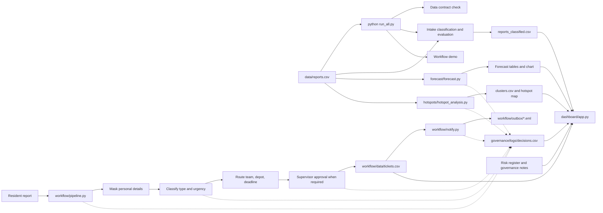

# Report Radar Technical Documentation

## Overview

Report Radar helps a municipality plan for citizen service reports. It classifies reports, estimates upcoming workload, shows where reports cluster, and provides a workflow for assigning and reviewing tickets. All project data is synthetic; results describe the example data, not verified conditions in Alexandra.

The main users are residents who submit reports and check their ticket, service team members who work the assigned queue, supervisors who review urgent or unclear tickets, and managers who use workload and area summaries for planning.

This guide treats the six system modules as **Data, Intake, Forecast, Hotspots, Workflow, and Dashboard**. Governance is a cross-cutting layer used by the modules to manage privacy, fairness, transparency, and risk.

## Architecture

The build command validates and prepares the shared data outputs. Separately, a resident report enters the workflow pipeline. The dashboard reads the resulting files and workflow records.



`run_all.py` runs six build steps in order: data check, classification, classifier evaluation, forecast, hotspot analysis, and a workflow demo. The Streamlit dashboard reads the generated outputs and workflow data. If a data file is missing, it can show labelled example data instead.

## Modules

### Data

- **Purpose:** provide the shared synthetic reports and check that they follow the agreed data contract.
- **Main files:** `data/reports.csv`, `data/check_data.py`, `data/generate_reports.py`.
- **Input and output:** the check reads the reports CSV and validates its columns, values, timestamps, and coordinates. It also writes `data/weekly_volume.png`.
- **Key rules:** the data contract defines six service categories, urgency values from 1 to 5, six named wards, and report status values. `hours_to_resolve` may be empty for unresolved reports.
- **Related documentation:** [Data README](../data/README.md) and [Data Card](../governance/data_card.md). There is no dedicated Data model card.

### Intake

- **Purpose:** estimate a report's service category and urgency, and flag reports that need a person to check them.
- **Main files:** `intake/classifier.py`, `intake/evaluate.py`, `intake/llm_classifier.py`.
- **Input and output:** a report description produces a category, urgency, review flag, and reason. The batch classifier writes `intake/data/reports_classified.csv`.
- **Key rules:** the keyword classifier uses weighted phrases. Ties, missing service clues, thank-you messages, or multiple strong problems are sent for review as `other`. The optional LLM path is not required for the project to run and falls back to keyword rules if unavailable.
- **Model card:** [Classifier model card](../governance/model_cards/classifier.md).

### Forecast

- **Purpose:** estimate weekly report workload for the next four weeks so managers can plan capacity.
- **Main files:** `forecast/forecast.py`, `forecast/output.csv`, `forecast/projected_workload.csv`, `forecast/metrics.json`.
- **Input and output:** it counts reports by week from `data/reports.csv` and writes forecasts, ranges, metrics, insights, and a chart.
- **Key rules:** four simple methods are compared with a recent backtest; the method with the lowest mean absolute error is selected. A likely range is an error-based guide, not a statistical confidence interval.
- **Model card:** [Forecast model card](../governance/model_cards/forecast.md).

### Hotspots

- **Purpose:** group report locations and rank geographic clusters by report count.
- **Main files:** `hotspots/hotspot_analysis.py`, `hotspots/clusters.csv`, `hotspots/clustered_reports.csv`, `hotspots/hotspot_map.html`.
- **Input and output:** the analysis uses report latitude and longitude, then writes cluster summaries, an interactive map, and insights.
- **Key rules:** KMeans groups nearby coordinates; clusters are geometric groups, not ward boundaries. A high count describes reports in the dataset, not necessarily the true number of incidents.
- **Model card:** [Hotspots model card](../governance/model_cards/hotspots.md).

### Workflow

- **Purpose:** take one report from intake through routing, review, ticket storage, notification, and logging.
- **Main files:** `workflow/pipeline.py`, `workflow/routing.py`, `workflow/approvals.py`, `workflow/notify.py`.
- **Input and output:** a description and ward produce a ticket, saved in `workflow/data/tickets.csv`; notification messages are saved in `workflow/outbox/`.
- **Key rules:** routing uses the category and ward lookup tables. SLA deadlines depend only on urgency, never on ward or report volume. The current SLA assumptions are urgency 5: 24 hours, 4: 48, 3: 72, 2: 168, and 1: 336. Urgency 4-5, unclear reports, and manually changed teams require supervisor review. Reassignment and rejection require a note.
- **Model card:** [Workflow model card](../governance/model_cards/workflow.md). Its note that routing, approval, and notification stand-ins are in use is out of date: the current modules are present, as described in [workflow/README.md](../workflow/README.md). The pipeline retains stand-ins only as a fallback if a module function is unavailable.

### Dashboard

- **Purpose:** present the report, forecast, hotspot, governance, and workflow information to residents, team members, supervisors, and managers.
- **Main files:** `dashboard/app.py`, `dashboard/workflow_tab.py`, `dashboard/risk_tab.py`, `dashboard/capacity.py`.
- **Input and output:** the app reads the dataset, classifier output, forecast files, hotspot files, governance information, and workflow tickets. It provides six tabs: Overview, Forecast, Problem areas, Reports, Risk & compliance, and Workflow.
- **Key rules:** if a prepared data file is missing, the app uses labelled example data for that view. It keeps resident email addresses out of dashboard displays.
- **Related documentation:** [Deployment guide](deployment.md). There is no dedicated Dashboard model card.

## Data

The shared report contract is defined in [data/README.md](../data/README.md) and checked by `data/check_data.py`. Its columns are `report_id, timestamp, category, description, ward_or_suburb, latitude, longitude, urgency, status, hours_to_resolve`. The dataset is synthetic. Empty `hours_to_resolve` values are expected for unresolved reports.

The workflow ticket contract is defined in [workflow/README.md](../workflow/README.md) and enforced by `workflow/pipeline.py`. In order, its columns are `ticket_id, received_at, description_masked, ward, resident_contact, category, urgency, review_required, reason, assigned_team, depot, sla_hours, due_by, status, approval_status, approver, decision_note, last_updated`.

The workflow stores only whether a resident provided contact details (`resident_contact`), not their email address. A real address is passed to the notification step when supplied; it is not written to the ticket, outbox, or decision log. If all SMTP settings are configured, the notification code sends the message through the configured mail provider.

## Setup and running

Use Python 3.10 or newer. From the repository root, install the dependencies and run the build and dashboard:

```bash
python -m pip install -r requirements.txt
python run_all.py
streamlit run dashboard/app.py
```

`run_all.py` stops at the first failed step. The dashboard command starts the local app. The [deployment guide](deployment.md) describes the [live dashboard](https://reportradar.streamlit.app), its temporary storage, and the post-deployment check.

## Testing

Run the project tests from the repository root:

```bash
python -m pytest forecast intake dashboard governance workflow
```

The test groups cover forecast calculations and output contracts; classifier categories, urgency, review, and fallbacks; dashboard capacity, summaries, and tabs; governance privacy, logging, fairness, and risk data; and workflow routing, approvals, notifications, and ticket processing.

**Verified result:** 246 tests passed in the run used to prepare this guide. Re-run the command after changes; the count may change as tests are added or removed.

## Security, privacy, and responsible AI

- **Synthetic data:** repository reports are generated examples, not real resident submissions.
- **Masking:** `governance/privacy.py` masks common phone numbers, ID numbers, email addresses, house numbers, and names before text is logged or sent to the optional LLM. Pattern matching can miss unusual formats.
- **Email:** messages are saved to the local outbox by default. Real sending occurs only when `SMTP_HOST`, `SMTP_USER`, and `SMTP_PASSWORD` are all set. The notification code masks saved message content and does not save the resident's address.
- **Decision log:** `governance/logger.py` records the component, report ID, masked input summary, output, reason, and rule version. Summaries are limited to 80 characters; rows older than 365 days are pruned when the log is written.
- **Human review:** supervisors approve, reassign, or reject urgent and unclear tickets. The classifier is a first sort, not a final decision-maker.
- **Governance records:** see the [POPIA checklist](../governance/popia_checklist.md), [risk register](../governance/risk_register.csv), [transparency notes](../governance/transparency_notes.md), and [classifier bias review](../governance/classifier_bias.md).

The checklist records gaps that must be addressed before real data is used, including dashboard access control, a retention rule for reports, and a way for residents to see and correct their reports. The risk register and model cards describe additional fairness, privacy, and over-trust risks.

## Known limits and future work

- **Synthetic evidence:** results do not establish actual service patterns in Alexandra. Validate the system with appropriately protected, consented real data before operational use.
- **Classifier:** unfamiliar wording and languages can be missed. The intake evaluation reports category errors on its tricky examples; have fluent speakers review translations and expand tests with independently written cases.
- **Forecast:** the forecast uses recent weekly counts and cannot anticipate one-off events such as storms or outages. Its likely range is based on past error.
- **Hotspots:** clusters describe where reports were recorded. Unequal reporting, synthetic coordinates, and geometric boundaries limit what the ranking can say about actual need.
- **Workflow operations:** SLA values are assumptions, not measured crew capacity. Check actual response times and crew availability; keep deadlines independent of ward.
- **Deployment:** the live app's tickets and decisions are temporary and reset when it restarts or rebuilds. A real service needs persistent storage, access controls, retention and correction processes, and operational review of email settings.