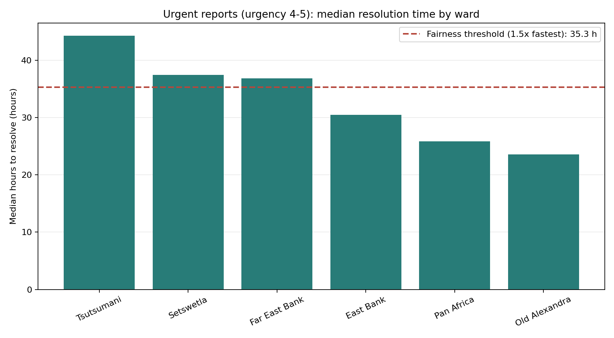

# Area Fairness Check

Run `python governance/area_fairness.py` from the project root to recalculate the CSV table and chart from `data/reports.csv`.

## Ward results

| Ward | Reports | Median resolution hours | Urgent median hours (urgency 4-5) | Not resolved | Average urgency | Assumed households | Reports per 1,000 households | Breaks rule |
|---|---:|---:|---:|---:|---:|---:|---:|:---:|
| Tsutsumani | 233 | 49.10 | 44.30 | 12% | 3.15 | 2,000 | 116.50 | Yes |
| Setswetla | 375 | 49.20 | 37.45 | 14% | 2.91 | 2,500 | 150.00 | Yes |
| Far East Bank | 564 | 51.90 | 36.85 | 12% | 3.09 | 4,500 | 125.33 | Yes |
| East Bank | 1,008 | 36.70 | 30.50 | 13% | 3.04 | 5,500 | 183.27 | No |
| Pan Africa | 626 | 37.90 | 25.85 | 14% | 3.09 | 4,000 | 156.50 | No |
| Old Alexandra | 1,188 | 33.50 | 23.55 | 13% | 3.06 | 8,000 | 148.50 | No |

The median resolution measures use reports marked resolved with a recorded `hours_to_resolve`; the urgent median uses only those reports with urgency 4 or 5. The unresolved share counts every report whose status is not `resolved`.

## Chart

## Fairness screening rule

Use the fastest ward's median resolved urgent duration as a comparison point. A ward is flagged when its median is **more than 1.5 times** that fastest median. Old Alexandra is fastest in this sample at 23.55 hours, giving a threshold of 35.33 hours. Tsutsumani (44.30), Setswetla (37.45), and Far East Bank (36.85) are above it. This is a practical screening rule for reviewing service outcomes, not a legal standard or proof of unfair intent.

## Household assumption

There is no census or official household dataset in this project. The household counts in the script and table are clearly labeled **assumptions** used only to demonstrate reports per 1,000 households; those rates are not reliable population-adjusted comparisons. A municipality should replace them with its latest approved census or administrative household estimates, confirm that their boundaries match these wards, and record the source and reference date before publishing or using the rates.

## Feedback loop and mitigations

The hotspot map ranks areas by report count, so crews may be sent first to busy areas. If quieter wards then receive slower service, residents may lose trust or face barriers that make reporting harder; fewer reports make those wards look even quieter the next time the map is ranked. This can reinforce an initial difference even if the original report counts did not reflect the true level of need.

- Include urgency and verified reports-per-household rates in prioritization instead of relying on raw counts alone.
- Guarantee a minimum service level for every ward, and review urgent backlogs and resolution times by ward regularly.
- Investigate wards with low reporting through community feedback and accessible reporting channels; low counts should trigger a check, not an assumption of low need.

## What this data can and cannot tell us

These are synthetic records, so the results describe this sample and do not establish actual municipal service performance. Within the sample, completed urgent reports in Tsutsumani took longer to resolve by the measured median than in Old Alexandra. The data cannot show that anyone intentionally treated a ward unfairly, explain why the difference occurred, or establish that report volume equals underlying need. The duration medians exclude reports that are not resolved or have no recorded duration, so they do not capture how long currently open reports have already waited. The household rates also depend on placeholder counts. Treat the flags as prompts for a real-world audit using validated household data, operational context, and community input.